

  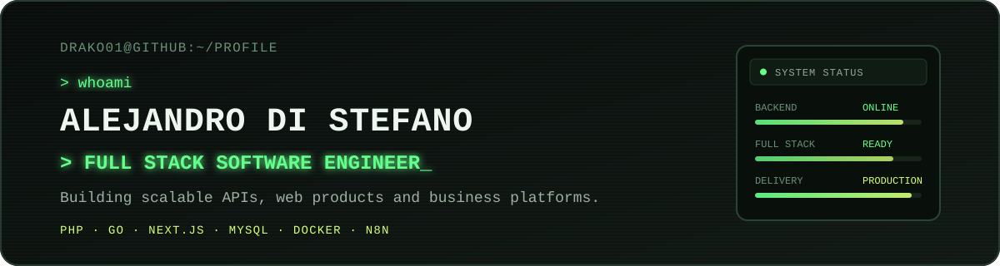

  <a href="https://distefano-alejandro.vercel.app/">Portfolio</a> ·
  <a href="https://armotusitio.com.ar/">ArmotuSitio</a> ·
  <a href="https://www.linkedin.com/in/alejandro-daniel-di-stefano/">LinkedIn</a>

I am a **Backend & Full Stack Software Engineer** based in Argentina, focused on building
business applications, SaaS products, APIs, and the systems that support them in production.

I work across **Go, PHP, Node.js, TypeScript, React, and Next.js**, with experience in relational data,
authentication, RBAC, cloud infrastructure, observability, and CI/CD. I have worked on both product
teams and independent software projects.

I also use **AI-assisted development** (Claude Code, Codex, skills, and validation workflows) to
accelerate implementation while keeping code review, testing, and technical decisions under human control.

**Open to Backend and Full Stack Software Engineer opportunities.**

- Backend architecture, REST APIs, authentication, RBAC, and business-critical workflows.
- Full stack products, SaaS platforms, e-commerce, backoffices, and internal tools.
- Business automation with webhooks, cron jobs, n8n, queues, and third-party integrations.
- CI/CD, Docker-based delivery, cloud infrastructure, observability, and production support.
- Code reviews, testing, documentation, mentoring, and developer education.
- Infrastructure as code and configuration management with Terraform and Ansible.
- AI-assisted delivery with Claude Code, Codex, reusable skills, and verification workflows.

| Area | Technologies |
| --- | --- |
| **Backend** |       |
| **Frontend** |      |
| **Data** |      |
| **DevOps** |        |
| **Tools** |         |
| **Observability** |    |
| **Infrastructure tools** | AWS CloudFront · Lens · Leap · Terraform · Ansible |

### ArmotuSitio 2.0 — Business platform & work management

<a href="https://armotusitio.com.ar/">
  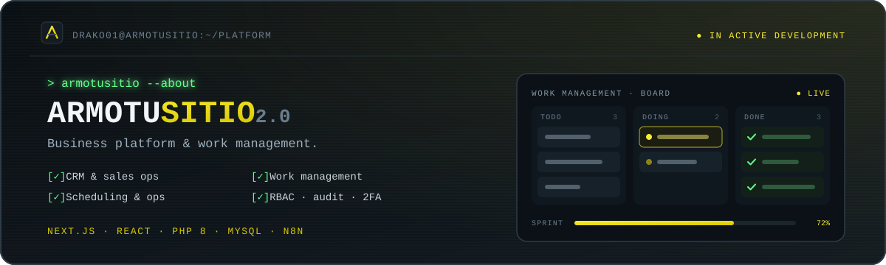
</a>

**ArmotuSitio 2.0** is my flagship business software project: an actively developed, modular platform that brings operational workflows, customer management, and project delivery into a unified experience.

**Product and business scope**

- **CRM and commercial operations:** customer records, leads, budgets and quotations, service/product management, and business follow-up.
- **Work management:** epics, projects, issues and tasks; Kanban boards, backlogs, sprints, dependencies, rich-text editing, and attachment workflows.
- **Operational modules:** appointments, scheduling, coordination, customer interactions, and integrations designed around practical business needs.
- **Governance and administration:** roles and permissions, auditability, validation, and tools for running business processes consistently.

**Engineering and architecture**

- **Frontend:** Next.js, React, TypeScript, responsive backoffice interfaces, and static-export deployment where required.
- **Backend and data:** PHP service/API layers, MySQL, modular responsibilities, and structured business data.
- **Security:** role-based access control, protected sessions, CSRF defenses, optional two-factor authentication, and authorization boundaries.
- **Delivery:** automated testing, CI/CD, integration workflows, maintainability, and incremental releases.
- **Experience:** multilingual content (ES/EN/PT), accessibility considerations, and responsive UX.

This is **ongoing product development**, not a claim that every planned module is already commercially available. The source code is private; the product and technical experience are documented without exposing confidential implementation details.

**[Visit ArmotuSitio](https://armotusitio.com.ar/)**

### ArmotuSitio IDE — AI coding, without losing control

<a href="https://armotusitio.com.ar/ide/">
  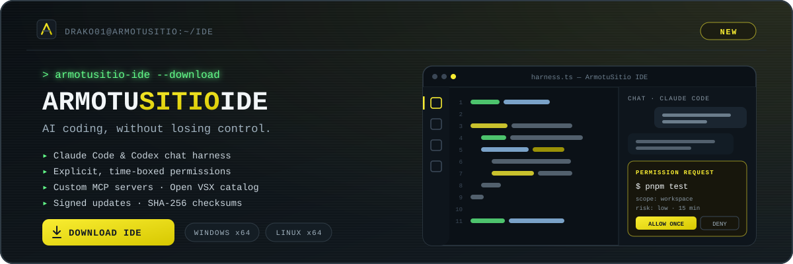
</a>

**ArmotuSitio IDE** is my own code editor, built on **Code - OSS**, where **Claude Code** and **Codex** work on your project under the permissions you approve.

- **Chat harness:** the AI reads, edits, runs commands and uses git, and every sensitive action shows what, where, the risk and how long the permission lasts.
- **Project harness:** tests, lint and typecheck with history, cancellation and evidence.
- **Integrations:** isolated AI accounts per provider, custom MCP servers with browser-based OAuth, and ArmotuSitio Work Management from the chat.
- **Distribution:** Open VSX extension catalog, signed update manifests and SHA-256 checksums for every installer.

**[Download ArmotuSitio IDE](https://armotusitio.com.ar/ide/)** — Windows x64 (installer and portable) and Linux x64 (`.deb`, `.rpm`, `.tar.gz`).

A growing collection of **production-oriented VS Code extensions**, built for CI/CD quality, code review, environment diagnostics and API performance. Click a card to view it in Open VSX.

<!-- OPEN_VSX_EXTENSIONS:START -->

  <a href="https://open-vsx.org/extension/armotusitio/orquestivo">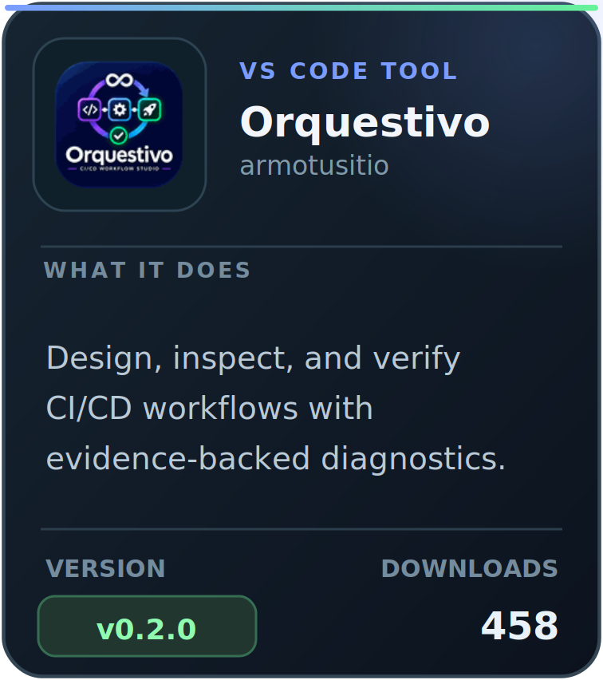</a>
  &emsp;
  <a href="https://open-vsx.org/extension/armotusitio/probato-pr">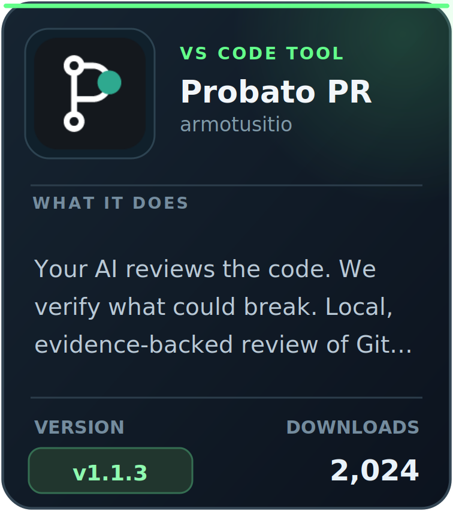</a>
  &emsp;
  <a href="https://open-vsx.org/extension/armotusitio/indizivo">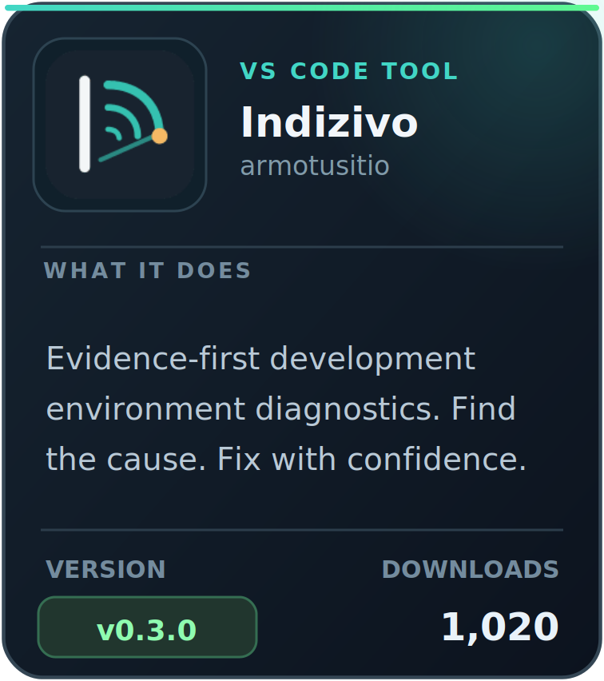</a>

  <a href="https://open-vsx.org/extension/armotusitio/saturivo">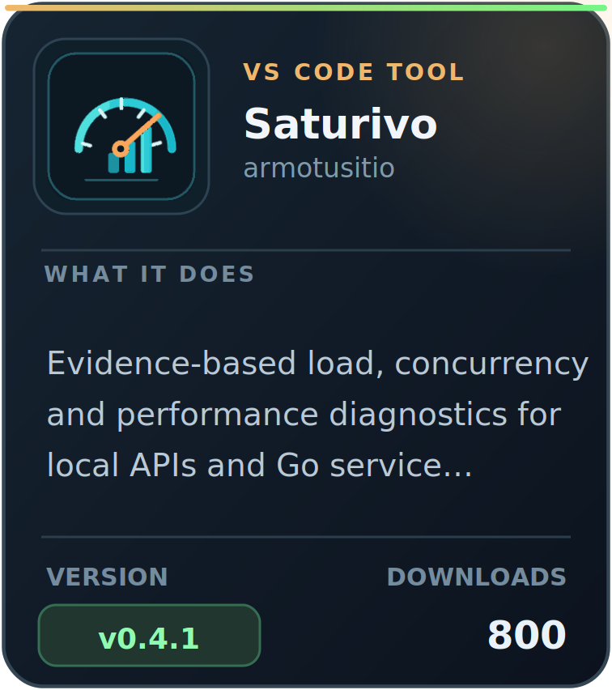</a>
  &emsp;
  <a href="https://open-vsx.org/extension/armotusitio/armotusitio-icons">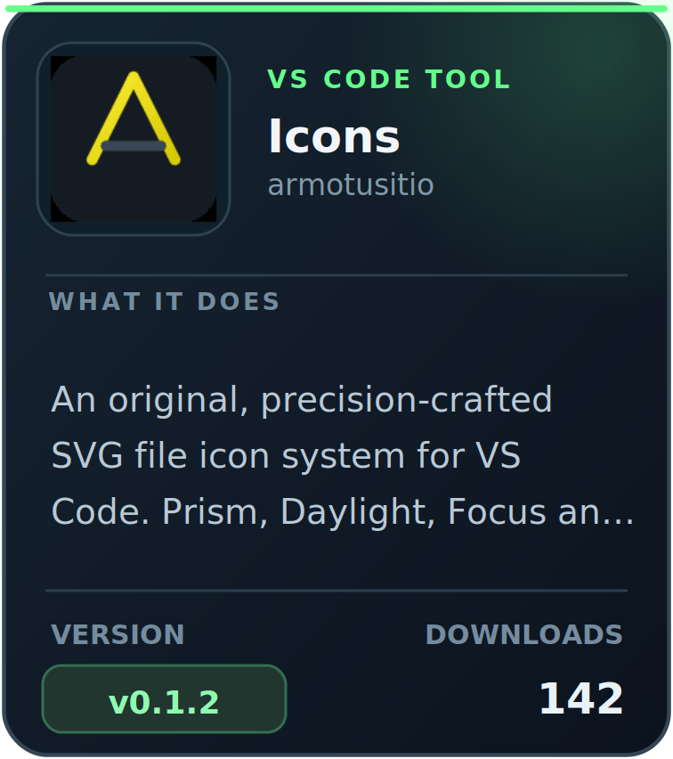</a>
  &emsp;
  <a href="https://open-vsx.org/extension/armotusitio/armotusitio-theme">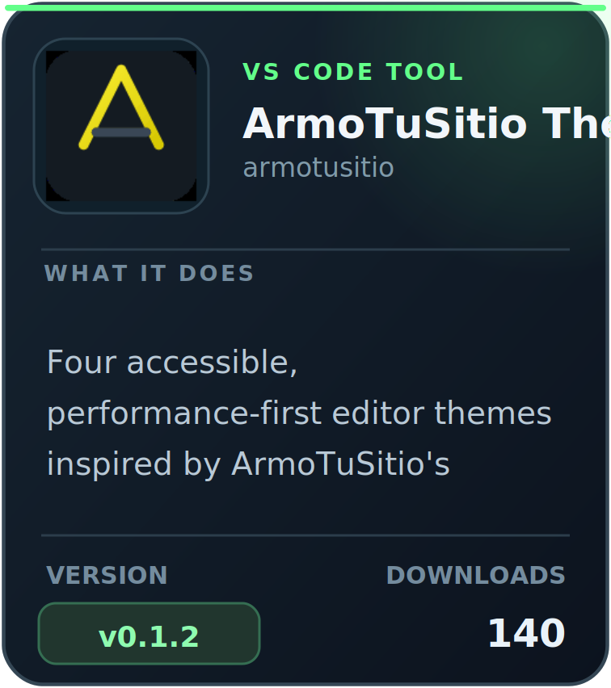</a>

  <a href="https://open-vsx.org/extension/armotusitio/noditrivo">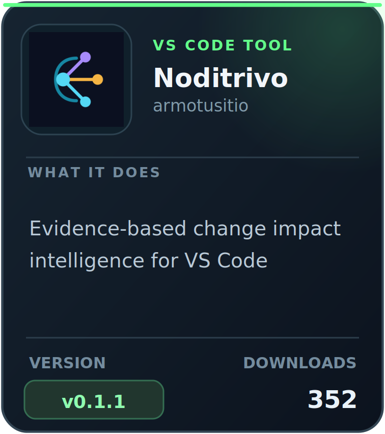</a>
  &emsp;
  <a href="https://open-vsx.org/extension/armotusitio/vestigivo">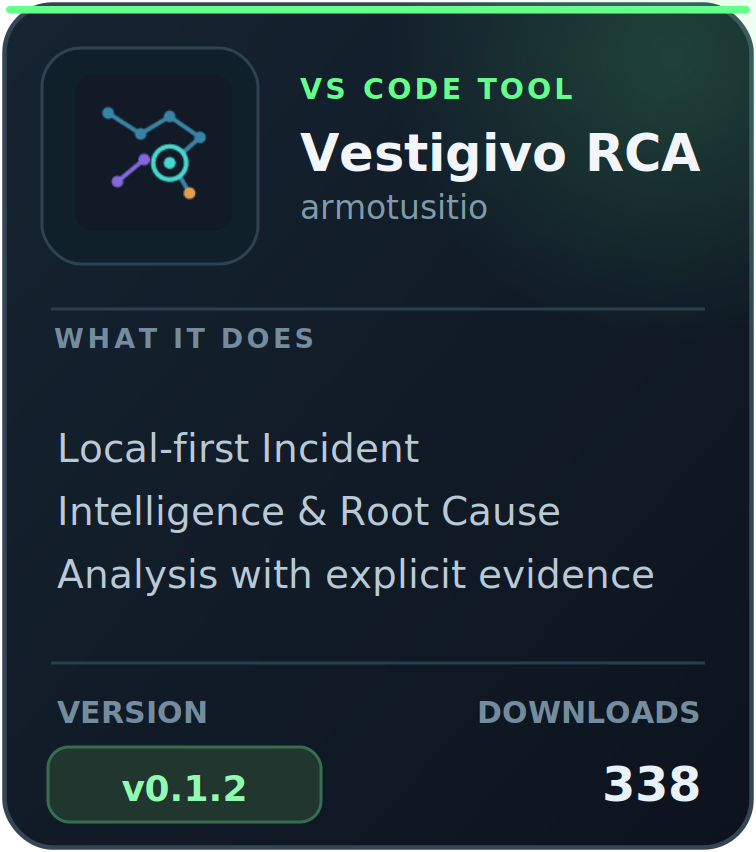</a>
  &emsp;
  <a href="https://open-vsx.org/extension/armotusitio/vinculivo">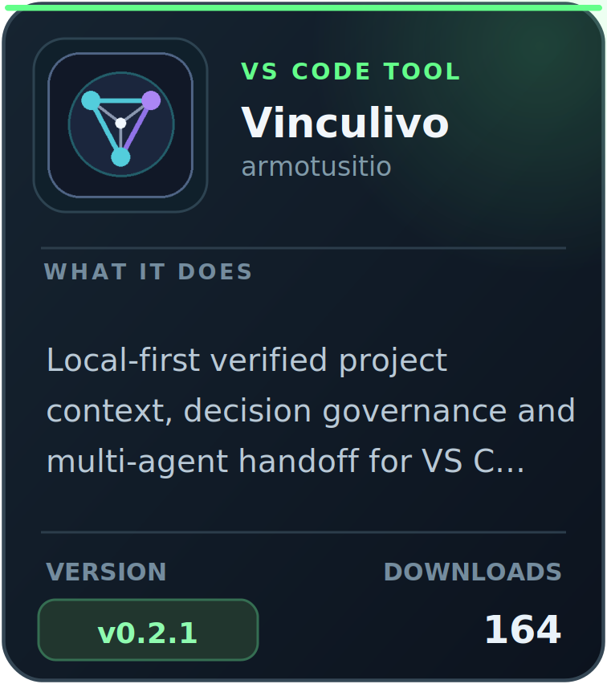</a>

<!-- OPEN_VSX_EXTENSIONS:END -->

Open VSX versions and downloads are checked hourly. Changes are proposed in a validated automated PR and merged only when branch protection permits.

| Period | Role and impact |
| --- | --- |
| **Jan–Oct 2026** | **Full Stack Software Engineer, Digi Ventures** — SaaS onboarding and Full Stack features; AWS infrastructure maintenance, CloudFront-related operational monitoring, Grafana observability, Redis, Lens, and collaboration with Product and Customer Success. PR validation and AI-assisted development with Claude Code and skills. |
| **Nov 2024–Dec 2025** | **Team Leader — Backend / Cloud, Zelcar Games** — Go and PHP services, PostgreSQL, Redis, Kubernetes (GKE), Docker, Agones, Terraform, Ansible, observability, and CI/CD. |
| **2019–present** | **Founder / Full Stack Developer, ArmotuSitio** — business applications, e-commerce, APIs, backoffice systems, client projects, and delivery. |
| **Nov 2022–present** | **Programming Instructor, CoderHouse** — web and backend training, technical guidance, and project review. |

| Principle | What it means in practice |
| --- | --- |
| **Production first** | Failure paths, permissions, data integrity, logging, and deployment are part of the feature. |
| **Clear boundaries** | Controllers stay thin; services own business rules; repositories own persistence. |
| **Incremental delivery** | Small, backward-compatible changes are easier to verify, release, and operate. |
| **Product thinking** | Architecture decisions connect to the customer, operator, and business outcome. |

  

  
  

I am open to **Backend and Full Stack Software Engineer** opportunities, as well as relevant software product consulting work.

  
  

