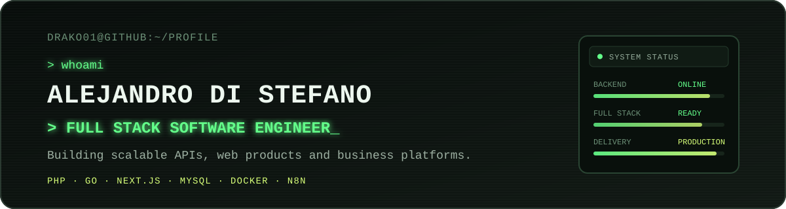
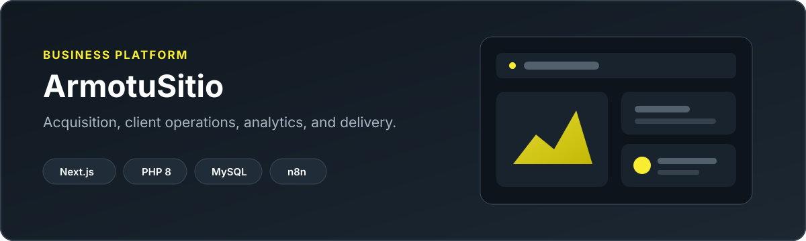
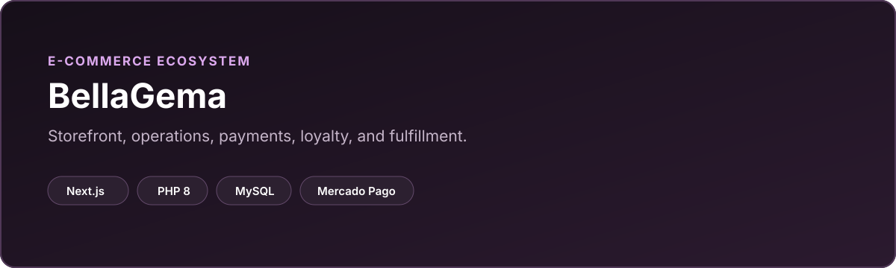

  

  <a href="https://distefano-alejandro.vercel.app/">Portfolio</a> ·
  <a href="https://armotusitio.com.ar/">ArmotuSitio</a> ·
  <a href="https://www.linkedin.com/in/alejandro-daniel-di-stefano/">LinkedIn</a>

I am a **Backend & Full Stack Software Engineer** based in Argentina, focused on building
business applications, SaaS products, APIs, and the systems that support them in production.

I work across **Go, PHP, Node.js, TypeScript, React, and Next.js**, with experience in relational data,
authentication, RBAC, cloud infrastructure, observability, and CI/CD. I have worked on both product
teams and independent software projects.

I also use **AI-assisted development** (Claude Code, Codex, skills, and validation workflows) to
accelerate implementation while keeping code review, testing, and technical decisions under human control.

**Open to Backend and Full Stack Software Engineer opportunities.**

- Backend architecture, REST APIs, authentication, RBAC, and business-critical workflows.
- Full stack products, SaaS platforms, e-commerce, backoffices, and internal tools.
- Business automation with webhooks, cron jobs, n8n, queues, and third-party integrations.
- CI/CD, Docker-based delivery, cloud infrastructure, observability, and production support.
- Code reviews, testing, documentation, mentoring, and developer education.
- Infrastructure as code and configuration management with Terraform and Ansible.
- AI-assisted delivery with Claude Code, Codex, reusable skills, and verification workflows.

| Area | Technologies |
| --- | --- |
| **Backend** |       |
| **Frontend** |      |
| **Data** |      |
| **DevOps** |        |
| **Tools** |         |
| **Observability** |    |
| **Infrastructure tools** | AWS CloudFront · Lens · Leap · Terraform · Ansible |

### ArmotuSitio 2.0 — business platform and project management

I design and develop a business management platform that combines CRM, client workflows,
budgets, role-based permissions, analytics, and an integrated project management module.

- **Project management:** epics, projects, tasks, Kanban boards, sprints, backlog, dependencies, capacity planning, and releases; inspired by workflows found in Jira and ClickUp.
- **Engineering:** PHP API and service layers, MySQL, Next.js, TypeScript, authentication, RBAC, and CI/CD.
- **Business features:** client portal, quotations, scheduling, integrations, and internal backoffice.

**Private source code.** [Visit ArmotuSitio](https://armotusitio.com.ar/)

### RedEvent — modular event-management SaaS

A privately developed SaaS project built around a **Go backend**, **PostgreSQL**, **Next.js**,
REST APIs, authentication, RBAC, modular applications, and automated quality checks.

- **Engineering focus:** API design, domain boundaries, multi-application architecture, testing, and CI/CD.
- **Development workflow:** automated verification and AI-assisted engineering workflows.
- **Status:** evolving project; not presented as a finished commercial product.

**Private source code.**

### BellaGema — e-commerce for a real business

Full Stack development of an e-commerce platform with storefront, catalog, cart,
checkout, order management, and backoffice operations.

- **Integrations:** Mercado Pago, shipping flows, and operational processes.
- **Stack:** Next.js, React, PHP, MySQL, and GitHub Actions.

**Private source code.** [Visit BellaGema](https://bellagema.com.ar/)

### Gestión Inmobiliaria — property management platform

A privately developed business application with a **Go backend**, **REST APIs**,
and a **Next.js frontend**, focused on property and rental management workflows.

- **Engineering focus:** domain modeling, service boundaries, data persistence, and application delivery.
- **Status:** evolving project.

**Private source code.**

### Public engineering examples

For code that can be reviewed publicly, explore my [repositories](https://github.com/Drako01?tab=repositories),
including documentation, API examples, and application experiments.

| Period | Role and impact |
| --- | --- |
| **Jan–Oct 2026** | **Full Stack Software Engineer, Digi Ventures** — SaaS onboarding and Full Stack features; AWS infrastructure maintenance, CloudFront-related operational monitoring, Grafana observability, Redis, Lens, and collaboration with Product and Customer Success. PR validation and AI-assisted development with Claude Code and skills. |
| **Nov 2024–Dec 2025** | **Team Leader — Backend / Cloud, Zelcar Games** — Go and PHP services, PostgreSQL, Redis, Kubernetes (GKE), Docker, Agones, Terraform, Ansible, observability, and CI/CD. |
| **2019–present** | **Founder / Full Stack Developer, ArmotuSitio** — business applications, e-commerce, APIs, backoffice systems, client projects, and delivery. |
| **Nov 2022–present** | **Programming Instructor, CoderHouse** — web and backend training, technical guidance, and project review. |

| Principle | What it means in practice |
| --- | --- |
| **Production first** | Failure paths, permissions, data integrity, logging, and deployment are part of the feature. |
| **Clear boundaries** | Controllers stay thin; services own business rules; repositories own persistence. |
| **Incremental delivery** | Small, backward-compatible changes are easier to verify, release, and operate. |
| **Product thinking** | Architecture decisions connect to the customer, operator, and business outcome. |

  

  
  

I am open to **Backend and Full Stack Software Engineer** opportunities, as well as relevant software product consulting work.

  
  

